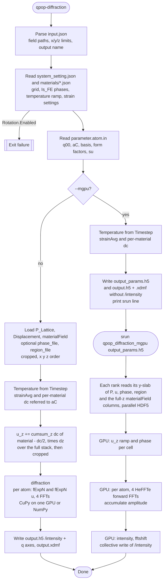

# Diffraction Flow And Monitor Contract

This page shows the runtime flow of `qpop-diffraction` and the multi-GPU program `qpop_diffraction_mgpu`, and the input contract that a q-pop-monitor integration needs to satisfy.

## Flowchart



## Stage Notes

- `system_setting.json` is the first hard dependency. It defines the grid, the materials (each `Is_FE` material is one phase), the temperature ramp and the strain settings. The `materials/` directory and `data/materialField_0.h5` are read from beside it.
- `parameter.atom.in` is not just chemistry metadata. It also provides the reciprocal-space target `q00`, the reference lattice `aC`, the atom basis, the phase-dependent complex form factors and the coefficients `su` that map P into atom-wise displacement.
- The strain reference is computed per snapshot. `Timestep` gives T. T gives each material's lattice, which sets `strainAvg` (in-plane, shifts the scattering centre `qC`) and `dc_m = c_m(T)/aC_z − 1` (out-of-plane, carried by a `u_z` ramp summed over the full stack before any crop).
- The amplitude is `S(k) Σ_a exp(−i(k+G)·R_a)/V [FFT(fExpN_a) − i k·FFT(fExpN_a u_a)]`, with `fExpN_a = Σ_p f_pa w_p exp(−i qC·u_a)` and `u_a = u + su·P`. That is four FFTs per atom.
- The weight `w_p` is phase p's fraction × `region` on cells of an `Is_FE` material, and 0 elsewhere. Without `phase_file` the fraction is one-hot from `materialField`; without `region_file` the region is 1.
- The two paths share `reciprocal_centre` (G, qC) and `q_axes`. Only the per-cell work moves to `qpop_diffraction_mgpu`.

## Input Inventory

The full reference is in [Inputs](inputs.md). In short:

- Run metadata: `system_setting.json` (`Mesh`, `Materials`, `BoundaryConditions.GeometryType`, `SimulationControls.Temperature`, `Solvers.ElasticStrain.InitialConditions`, `Rotation.Enabled` false) and `materials/<name>.json` (`Ferroelectric.Is_FE`, `Mechanical.LatticeConstants`, `Mechanical.ThermalExpansion`).
- Atomic metadata: `parameter.atom.in` (`q00`, `aC`, atom positions, and per phase the complex form factors and the P-to-shift coefficients), with one phase block per `Is_FE` material.
- Required fields: `P_Lattice_<step>.h5` (or `PLatt_<step>.h5`) with the `Timestep` attribute, and `data/materialField_0.h5`.
- Optional fields: `Displacement_<step>.h5` (zero when absent), `phase_file` (phase fractions), `region_file` (scattering weight).

All field datasets are `(nz, ny, nx)` over the full `Mesh`; any float type and compression are accepted.

## Produced Files

- `{output_file}.h5`: `/intensity` `(nz, ny, nx)`, `/q_x`, `/q_y`, `/q_z` in nm⁻¹, attributes `Timestep` and `q_units`.
- `{output_file}.xdmf`: ParaView sidecar.
- `{output_file}_params.h5` (`--mgpu` only): the inputs of `qpop_diffraction_mgpu`; see [Outputs](outputs.md).

## Q-Pop-Monitor Implications

- Basis vectors and form factors are not enough. The intensity also depends on `system_setting.json` (temperature ramp, substrate, misfit) through `strainAvg` and `dc`, and on the snapshot step.
- A monitor that validates inputs must check the field shapes against `Mesh` and the presence of `materialField_0.h5`. It must also check that `parameter.atom.in` has one phase block per `Is_FE` material.
- A monitor choosing the path should compare the cropped cell count with GPU memory. About 130 bytes per cell for `qpop_diffraction_mgpu` is a reasonable guide; above one GPU's worth, use `--mgpu`.
- The `--mgpu` setup is cheap and never loads fields. It can run on a login node; `qpop_diffraction_mgpu` needs a GPU allocation.

## Proposed Monitor Schema

```json
{
  "run": {
    "systemSetting": "system_setting.json",
    "materialField": "data/materialField_0.h5",
    "step": 0
  },
  "atomic": {
    "path": "parameter.atom.in",
    "q00": [0.0, 0.0, 0.0],
    "aC": [[0.0, 0.0, 0.0], [0.0, 0.0, 0.0], [0.0, 0.0, 0.0]],
    "nAtom": 0,
    "nPhase": 0
  },
  "fields": {
    "platt": {"path": "data/P_Lattice_0.h5", "present": true},
    "displacement": {"path": "data/Displacement_0.h5", "present": false},
    "phase": {"path": null, "present": false},
    "region": {"path": null, "present": false}
  },
  "limits": {"x": null, "y": null, "z": null},
  "multiGpu": {"enabled": false, "ranks": 1},
  "outputs": {
    "diffraction": "diffraction.h5",
    "xdmf": "diffraction.xdmf",
    "params": "diffraction_params.h5"
  }
}
```

## Recommended Next Step For Integration

- Collect the `run` and `atomic` blocks first; they decide whether the inputs are consistent.
- Treat the field files as attachments with an explicit present or absent state.
- Choose `multiGpu.enabled` from the cell count, and record the timing and memory that `qpop_diffraction_mgpu` prints with the run.
